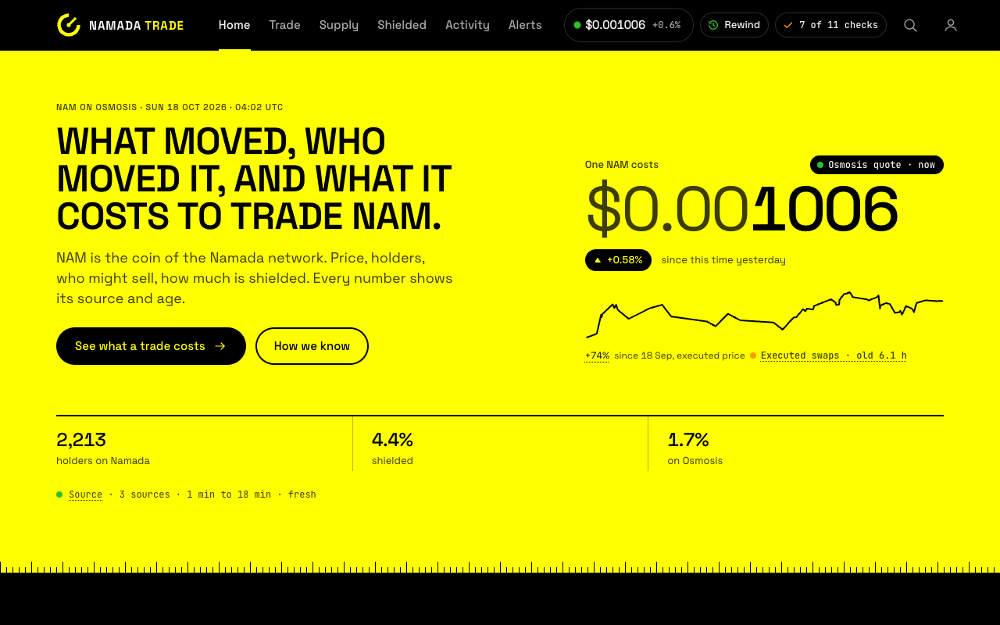

# NamadaTrade

**Live: [namada.trade](https://namada.trade)**: what moved NAM, who moved it, and what it costs to trade it, in plain words, with every number's source and age.



NamadaTrade reports public on-chain and exchange data. It is not investment advice, it never trades for you, and it is not affiliated with Namada, Heliax or the Anoma Foundation.

What moved NAM, who moved it, and what it costs to trade it. Cloudflare Worker + D1 + Durable Object (live stream) + a React UI in plain CSS (cascade layers, tokens from `docs/design/tokens.css`).

The UI is built to `docs/design/system.md` (the design system) and `docs/design/build-plan.md`; the reference pages and shots are in `docs/design/final/`, the build's own shots in `docs/design/build-shots/`. Each screen names the decision it serves (see [docs/decisions.md](docs/decisions.md)):

| route | decision | what it answers |
|---|---|---|
| **Home** `/` | | The price with its source and age, what changed in 24 hours, where all the NAM is, who holds it, how NAM gets from a wallet to a sale, a mini quote, and why the numbers can be trusted. |
| **Trade** `/trade` | D1 | If I sell or buy X now, what do I get? Live quote (or the size table when the quote service is down), price move, executed vs quoted price, how size moves the price, pools. |
| **Supply** `/supply` | D2 D3 D4 | Is a big sale coming? NAM bridged to Osmosis and not yet sold, unstaking and restaking, who is moving the price, votes in progress. |
| **Shielded** `/shielded` | D5 | How much NAM sits in the shielded pool, its trend, and the largest moves out. |
| **Activity** `/activity`, `/holders` | | Every move with its source; the holder list. |
| **Alerts** `/alerts` | D7 | What crossed an alert size, the rules, where alerts go. |
| **Sources sheet** (header check pill) | D6 | Every source, its age, and the cross-checks. |
| `/staking`, `/osmosis`, `/learn/how-nam-trading-works`, `/faq` | | Plain-language pages for search (`shared/copy.ts` is the one source for their text and the server-rendered page). |

Every number carries provenance (`source`, `at`, `status: live | stale | missing | conflict`, shown as fresh, old, no data, sources disagree). There are no hard-coded fallbacks: when a source fails you see "—" and the reason.

**Rewind:** add `?at=<unix ms>` to any route (or use Rewind in the header or the search palette) and every decision endpoint recomputes from the index as of that moment. Live quotes are off while rewound; holder balances are current and the UI says so.

## Sign-in

Everything is readable without signing in. Alert rules, the watchlist and the Discord webhook belong to an address, so saving them requires proof of ownership: a **signed message**, never a transaction.

- **Namada Keychain** (desktop extension): ed25519 `signArbitrary`. The Worker checks the key against the address two ways: it derives the implicit address from the key (`sha256(borsh pk)[0..20]` behind a `0x00` discriminant, bech32m `tnam`) and compares with the key the chain has revealed (`indexer.namada.net/api/v1/revealed-public-key`).
- **Keplr** (osmo1, works inside the Keplr mobile app's browser): ADR-36 `signArbitrary`, secp256k1 over the amino sign doc; address = `bech32("osmo", ripemd160(sha256(pubkey)))`.
- **Pair a phone**: a signed-in desktop makes a one-time 8-character code (10 min) shown as a QR deep link `/alerts?pair=CODE`; the phone claims it and gets a session for the same address. The phone never holds a key.

Login is shown by capability (`window.namada` / `window.keplr` present), not by device. Sessions are bearer tokens (30 days) in the `kv` table; nonces are single-use and expire in 5 minutes; the cron sweeps expired rows. Tests: `test/auth.test.ts` (includes a real on-chain key→address vector).

### Settings and privacy (`/settings`, `/api/me/*`)

Per-user: one switch and threshold per alert rule, watchlist, forum/governance, quiet hours (UTC), Discord channel, signed-in devices (revoke), API keys (year-long bearer tokens, shown once), export, delete-everything.

Everything a user saves is one AES-256-GCM blob under `kv` key `user:<address>`, encrypted with the `SETTINGS_KEY` secret (`wrangler secret put SETTINGS_KEY`, 32 random bytes base64; also in `.dev.vars`). D1 exports contain ciphertext only; the API never returns the webhook URL, only a mask; decryption happens only in the alert dispatcher (`worker/src/sources/discord.ts`) and the `/api/me` handlers. The Privacy page states the limit plainly: whoever can deploy the Worker could change the code. Tests: `test/settings.test.ts`.

## Run

```bash
npm install
npm run dev            # build UI, start wrangler dev on :8787 (local D1)
npm run typecheck
npm test               # parsers + replay harness
npm run build          # runs `npm run gen` (the dated proof block and chart markers) then vite build
```

UI against production data (read-only): `API_TARGET=https://namada.trade PORT=5199 npx vite --config web/vite.config.ts`.

### Gates (build-plan section 8)

```bash
node --experimental-strip-types scripts/contrast.ts    # G4: every token pair in system.md 4.1, both themes
node --experimental-strip-types scripts/copy-lint.ts   # G5 banned words and N2 typed numbers in web/src/**/*.tsx
node --experimental-strip-types scripts/budgets.ts     # G9: initial JS and fonts of web/dist (after npm run build)
npm run e2e            # Playwright, six viewports: every screen spec plus web/e2e/gates.spec.ts (axe, copy, overflow and targets, motion, layout shift, N1 to N9)
node scripts/shoot.mjs <url> <out.png> <width> <height> [--full] [--light] [--reduced]   # exact-width shot and layout audit
```

Local D1 starts empty. To work with real data, export production (`npx wrangler d1 export namada-trade-db --remote --output=backup.sql`) and load its `INSERT` lines into the local sqlite file under `.wrangler/state/v3/d1/`.

Secrets: `.dev.vars` locally (`KEPLR_KEY`, `DISCORD_WEBHOOK_URL`), `wrangler secret put` in production.

## Data

| table | what |
|---|---|
| `flows` | one row per meaningful NAM action on either chain: swaps, IBC, transfers, shield/unshield, bond/unbond/withdraw (`meta.tsSource`, `meta.priceSource`, `meta.arb`, `meta.trader`, `meta.source`) |
| `moves` | raw balance deltas |
| `holders` | current balances with `verified_at` / `verified_src` |
| `stakes` | bonded NAM per address: `bonded_num` read from the chain (`vp/pos/delegations_at` + self-bond, ~120 addresses verified per cron tick), `estimated_num` from bond/unbond history until then |
| `labels` | pools, modules, genesis allocations, user tags |
| `address_links` | osmo1 ⇄ tnam1 pairs seen in IBC packets |
| `metrics` | time series: `price.usd` (SQS, 1-min), `price.swap_1h` (executed, hourly median), `supply.*`, `dex.*`, `epoch` |
| `checks` | cross-source integrity checks |
| `kv` | cursors, caches, `source.health`, `chain.params`, webhook configs |

Sources and their limits (as of 2026-10-16): Osmosis SQS (price, pools, router); Keplr Osmosis RPC/REST (holders, supply, live swaps); Namada RPC × 2 (events from height 7,682,174 = 2026-08-14 onward; ABCI balances only 3,600 blocks back); `indexer.namada.net` (full transfer history, chain parameters, governance); Namada forum. NAM has no CoinGecko/GeckoTerminal listing, so historical price is reconstructed from executed single-pool NAM/USDC swaps.

### Backfill

```bash
npm run backfill:history -- osmo-ts   # real block times for imported Osmosis rows (were stamped with import time)
npm run backfill:history -- price     # hourly executed price; re-values flows priced at import-day spot
npm run backfill:history -- namada    # pre-2026-08-14 Namada history from indexer.namada.net
npm run backfill:history -- masp      # daily shielded-pool balance read off chain post-balances; emits corrective MASP flows; series written only if the chain ledger closes within 2%
npm run backfill:history -- pos       # bond / unbond requests since genesis from the pulled history
npm run db:apply scripts/out/history/<file>.sql
```

## Proof

- **Event replay set:** `npm run events` builds [docs/events.json](docs/events.json) / [events.md](docs/events.md): the 10 largest price moves and 12 largest flows with every lead signal in the prior 48h.
- **Replay harness:** `npm run test:replay` runs the alert rules (`shared/alerts.ts`, the same code the Worker uses) against that set and writes [docs/replay-report.md](docs/replay-report.md): flagged/missed, lead time, timestamp exactness.
- **Timed task tests:** `npm run task-tests` writes [docs/task-tests.md](docs/task-tests.md): six questions with answers computed from D1 and the router, plus the protocol for running them with other traders on old UI / new UI / Osmosis app + explorer.
- **Cross-source checks** (cron, every minute, visible in the trust panel): IBC conservation (Namada escrow vs Osmosis supply), RPC agreement, supply partition, indexer height vs RPC, minted supply indexer vs ABCI, SQS mid vs executed price.

## Layout

```
worker/src/api.ts        HTTP API (Hono)
worker/src/analytics.ts  decision queries (pressure, blind spot, alerts), all parameterised by asOf
worker/src/cron.ts       1-min refresh, source health, checks
worker/src/live-hub.ts   Durable Object: Osmosis WS + Namada block polling → D1 + WebSocket fan-out
worker/src/parse/        event parsers (tested with fixtures in test/)
shared/types.ts          API contract; shared/alerts.ts alert rules
web/src/app/             shell: router, header, tab bar, footer, Rewind, palette, overview poll and stream
web/src/ui/              kit: provenance (Num, ProvChip, ProvDot, SourceLine, Sheet), controls, lists, charts (custom SVG)
web/src/screens/         one folder per screen, plus the sheets and the plain-language pages
web/src/styles/          tokens.css (copy of docs/design/tokens.css), components/*.css, screens/*.css
web/src/generated/       build-time exports from docs/replay-report.md and docs/events.json (npm run gen)
web/e2e/                 Playwright specs and the cross-route gates
scripts/                 backfills, event set, task tests, D1 apply
docs/                    decisions, events, replay report, task tests
```

## License

[MIT](LICENSE). The Namada name and marks belong to their owners; this project is independent and not affiliated with Namada, Heliax or the Anoma Foundation.
